<p align="center"><a href="https://galasulin.github.io/smart-home-showcase/">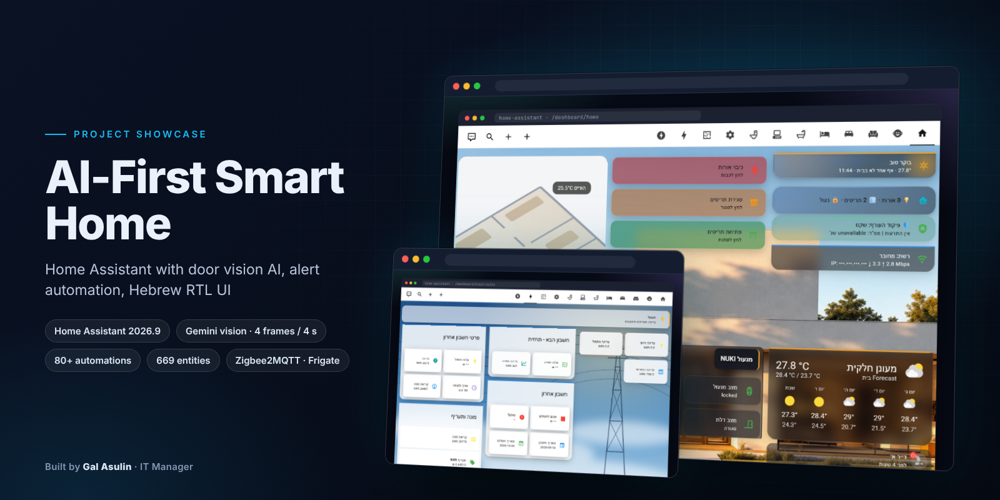</a></p>

<div align="center">

# בית חכם מבוסס AI

**בית על Home Assistant שתכננתי ובניתי מאפס: מצלמת כניסה עם ראייה ממוחשבת, תגובה אוטומטית להתראות טילים ומרכז שליטה בטלגרם, הכול בעברית.**

🇬🇧 [English](README.md) · 🇮🇱 עברית


[**דמו חי**](https://galasulin.github.io/smart-home-showcase/) · [מסכים](#מסכים) · [ארכיטקטורה](#ארכיטקטורה) · [טכנולוגיה](#פרמטרים-טכניים)

</div>

<div dir="rtl" align="right">

> **ריפו תצוגה.** הריפו מתעד איך הבית עובד ולמה הוא בנוי כך. שום דבר כאן לא מחובר לבית האמיתי. לא פורסמו תמונות ממצלמות, תוכנית דירה, מיקום, שמות, מספרים סידוריים, מספרי חשבון או מזהי צ'אט. הדמו החי הוא שחזור נאמן שרץ על נתוני דמו: אפשר ללחוץ על הדשבורד, להפעיל הדמיה של התראת טילים ולהריץ את ה-AI של מצלמת הכניסה על שבעה תרחישים במסדרון.

## במבט מהיר

| | |
|---|---|
| **סוג** | מערכת בית חכם (Home Assistant OS) ואתר תצוגה אינטראקטיבי |
| **סטטוס** | רץ 24/7 בדירה אמיתית |
| **סטאק** | Home Assistant 2026.9 · Zigbee2MQTT · Mosquitto · Frigate · go2rtc · LLM Vision + Gemini · Telegram |
| **התפקיד שלי** | תכנון, חומרה, אוטומציות, דשבורדים, פרומפטים ל-AI, ואתר התצוגה הזה |
| **דמו חי** | [galasulin.github.io/smart-home-showcase](https://galasulin.github.io/smart-home-showcase/) |
| **שפות** | עברית (ממשק, הקראה, התראות) · אנגלית (תיעוד ודוגמאות) |

| 669 | 80+ | 54 | 39 | 11 | 12 |
|:-:|:-:|:-:|:-:|:-:|:-:|
| **ישויות** | **אוטומציות** | **אינטגרציות** | **רכיבי HACS** | **תוספים** | **מסכי דשבורד** |

## מסכים

<table>
<tr>
<td width="33%"><a href="assets/dashboard-desktop.jpg">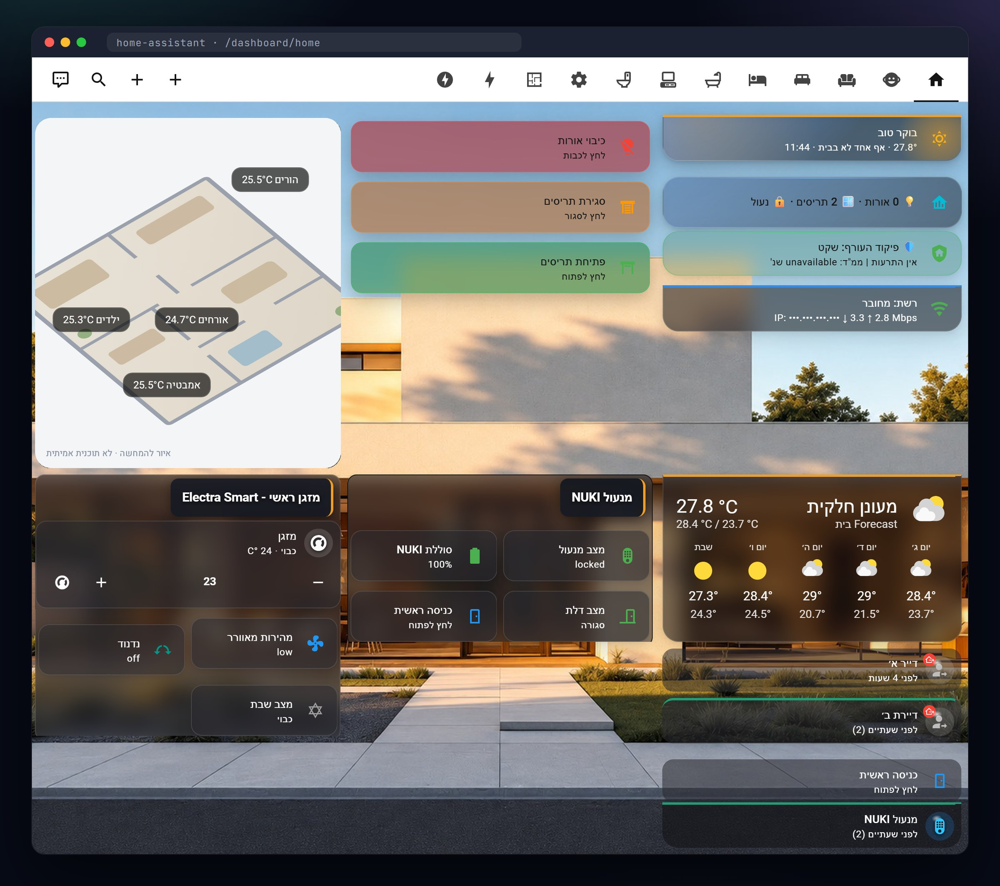</a><br><sub><b>מסך הבית</b> · כרטיסי זכוכית, RTL, מצב חי</sub></td>
<td width="33%"><a href="assets/dashboard-electricity.png">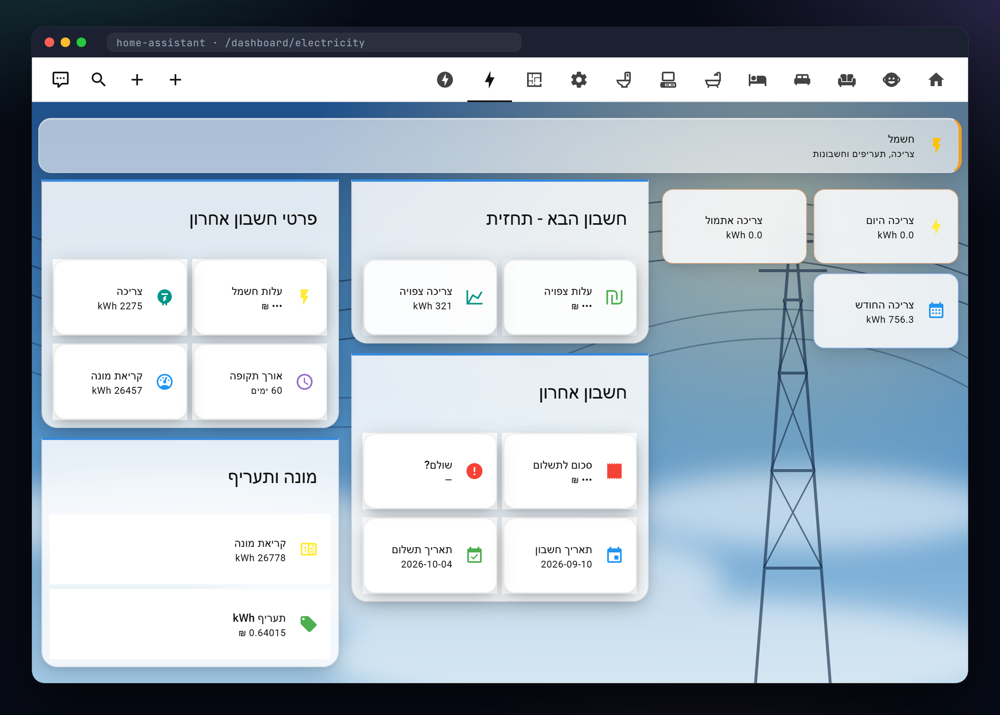</a><br><sub><b>חשמל</b> · מונה חכם, תחזית חשבון, תעריף</sub></td>
<td width="33%"><a href="assets/dashboard-alert.png">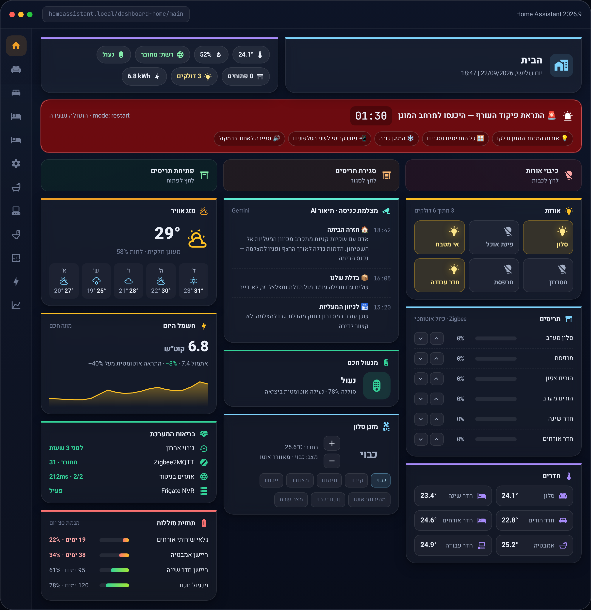</a><br><sub><b>מצב התראה</b> · ספירה לאחור ומה הבית כבר עשה (שחזור)</sub></td>
</tr>
<tr>
<td><a href="assets/mobile.png">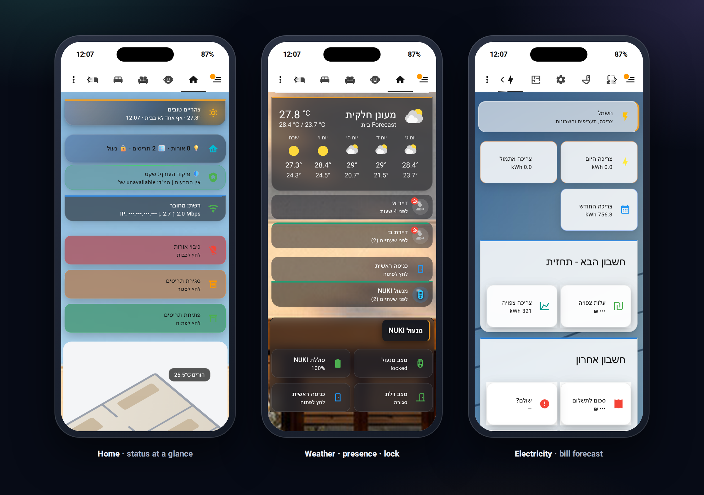</a><br><sub><b>מובייל</b> · בית, נוכחות ומנעול, חשמל</sub></td>
<td><a href="assets/door-ai-arriving.png">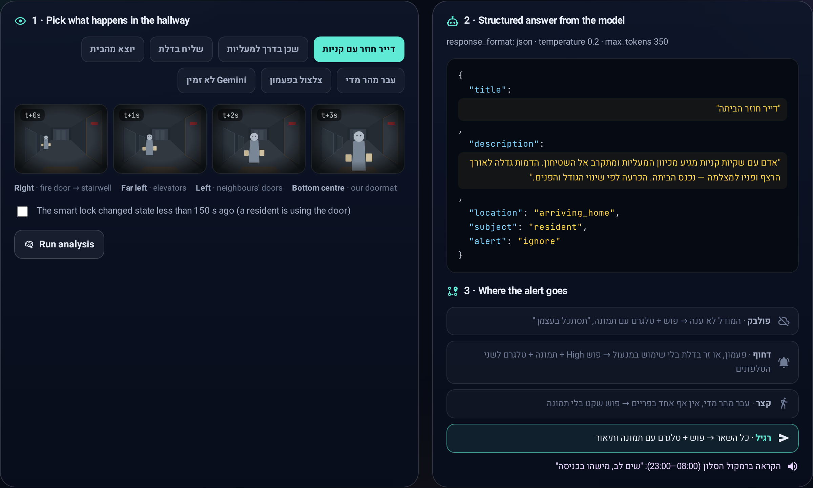</a><br><sub><b>AI בדלת</b> · דייר חוזר הביתה, בלי התראה</sub></td>
<td><a href="assets/door-ai-courier.png">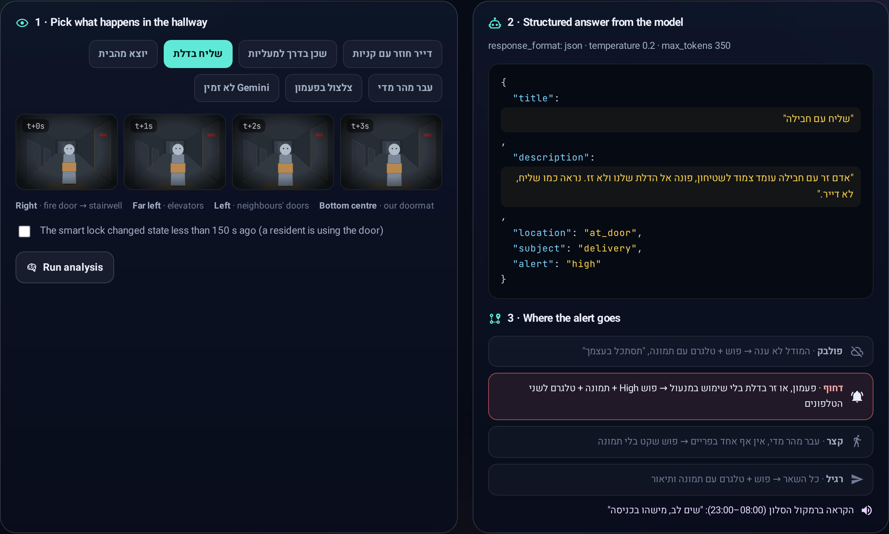</a><br><sub><b>AI בדלת</b> · שליח בדלת, מסלול דחוף</sub></td>
</tr>
<tr>
<td><a href="assets/telegram.png">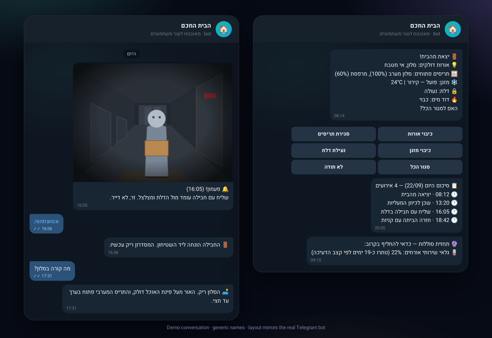</a><br><sub><b>בוט טלגרם</b> · מבט AI ותיקון בלחיצה (דמו)</sub></td>
<td><a href="assets/home-front-alert.png">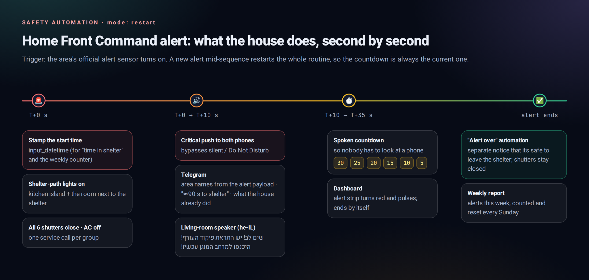</a><br><sub><b>ציר ההתראה</b> · 90 השניות הראשונות</sub></td>
<td></td>
</tr>
</table>

<sub>צילומי מסך אמיתיים מהמערכת הרצה, כרטיס אחרי כרטיס. לפני הצילום הוחלפו בדף שמות אנשים, כתובות IP וסכומי חשבון, ותוכנית הדירה האמיתית הוחלפה באיור. מסך ההתראה הוא שחזור, כי אי אפשר לביים התראה אמיתית. תמונות הרקע: תמונת הדמו של <a href="https://github.com/willsanderson/Hemma">Hemma</a> (רישיון MIT) ואיור מקורי.</sub>

## מה זה

רוב הבתים החכמים נעצרים ב"להדליק אור מהטלפון". הבית הזה **מבין מה קורה** ואומר את זה בעברית פשוטה. מצלמת הכניסה מבינה אם האדם שמולה חוזר הביתה, יוצא, שכן שהולך למעליות או שליח שעומד מול הדלת. כשמגיעה **התראת פיקוד העורף** לאזור, הבית מטפל לבד ב-90 השניות הראשונות. משני הטלפונים אפשר לכתוב בטלגרם *"מה קורה בסלון?"* ולקבל תשובה של שורה אחת שכתב מודל ראייה.

העיקרון הוא **מקומי איפה שזה חשוב**: ה-Zigbee לא מדבר עם ענן של יצרן, והווידאו מפוענח ומנותח ברשת הביתית עם Frigate. בענן אני משתמש במכוון: כמה פריימים נשלחים ל-Gemini, ההתראות יוצאות דרך טלגרם ו-push, ההקראה משתמשת ב-TTS ענני, וחלק מהמכשירים (שואבים, מזגן, טלוויזיה) מחוברים דרך הענן של היצרן.

> **הפילוסופיה:** אוטומציה צריכה *לעזור* לדיירים ולא להילחם בהם. הבית פועל לבד רק בחירום. בנוחות הוא קודם שואל ומחכה ללחיצה.

## יכולות מרכזיות

| יכולת | איך זה עובד |
|---|---|
| **AI בדלת הכניסה** | **4 פריימים לאורך 4 שניות** נשלחים ל-Gemini, יחד עם מפה כתובה של המסדרון וסכמת JSON עם ערכים סגורים. את כיוון התנועה קובע **שינוי הגודל בין הפריימים**. פעילות במנעול מבטלת התראות שווא, ונתב של ארבעה מסלולים מחליט מי מקבל מה. |
| **תגובה להתראת טילים** | מדליק את הדרך למרחב המוגן, סוגר את ששת התריסים, מכבה את המזגן, שולח **פוש קריטי שעוקף מצב שקט** ומריץ **ספירה לאחור בקול בעברית**. האוטומציה ב-`mode: restart`, כך שהתראה נוספת מתחילה את הרצף מחדש. |
| **מרכז שליטה בטלגרם** | `/salon`, `/entrance` או טקסט חופשי שולפים פריים חי ומחזירים תשובת AI של שורה אחת. כפתורים בהודעה מכבים אורות, סוגרים תריסים או מכבים מזגן. הגישה נעולה ל**רשימה של שני משתמשים**. |
| **סיכום יציאה מהבית** | שלוש דקות אחרי שטלפון יוצא מהאזור מגיעה הודעה אחת: כל אור שנשאר דולק, כל תריס פתוח ובאיזה אחוז, ומצב המזגן, המנעול ודוד המים. לכל פריט **כפתור תיקון בלחיצה**. |
| **ונטה על רדאר mmWave** | PIR ורדאר mmWave. הוונטה נדלקת רק אחרי **דקה שלמה של נוכחות שהרדאר אישר**, ויש לה **שלושה מסלולי כיבוי בלתי תלויים**, כך שחיישן תקוע לא ישאיר אותה דולקת. |
| **ריפוי עצמי ותחזיות** | ה-Zigbee עושה לעצמו restart ומסלים אם זה לא עזר. **סוף חיי הסוללה נחזה מראש** לפי מגמת 30 יום, 45 יום לפני. הגיבויים נבדקים, אתרים בניטור זמינות, וניטור החשמל מתריע על יום של ‎+40%. |
| **בלי התראה ביציאה מוכרת** | אם המנעול החכם השתנה ב-**150 השניות האחרונות**, מי שליד הדלת הוא אחד מאיתנו שיוצא, וההתראה לא נשלחת. |
| **שעות שקט** | בלי הקראה **בין 23:00 ל-08:00**. טלגרם ו-push נשלחים תמיד. |
| **דשבורדים בעבודת יד** | 12 מסכים עם mushroom, ‏card-mod ו-layout-card, משטחי זכוכית, פס עליון צבעוני של 3px לכל תחום, כרטיסים שמגיבים למצב דרך Jinja, ממשק מימין לשמאל. |

## ארכיטקטורה

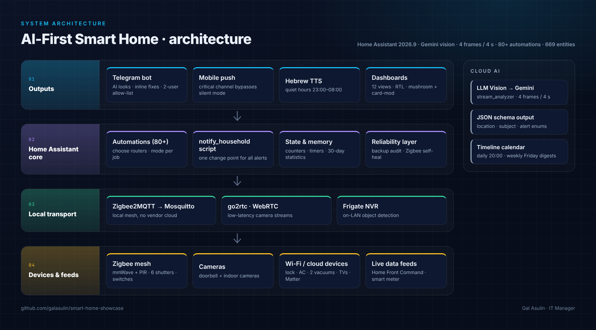

בשכבה התחתונה נמצאים המכשירים: רשת Zigbee מקומית, מצלמות, כמה מכשירי Wi-Fi וענן, ומקורות נתונים חיים כמו התראות פיקוד העורף והמונה החכם של חברת החשמל. תעבורת ה-Zigbee עוברת דרך Zigbee2MQTT אל Mosquitto, והווידאו עובר דרך go2rtc ו-Frigate, כך ששניהם נשארים ברשת הביתית. ליבת Home Assistant מריצה 80+ אוטומציות, 5 סקריפטים ורכיבי מצב (מונים, טיימרים, חיישני `statistics` של 30 יום). רק קריאות הראייה של הדלת ושל טלגרם יוצאות מהבית: LLM Vision שולח כמה פריימים ל-Gemini ומקבל בחזרה אובייקט JSON. כל התראה יוצאת דרך סקריפט התראות אחד אל טלגרם, push לנייד, הקראה בעברית והדשבורדים.

| שכבה | מה רץ בה |
|---|---|
| **מכשירים** | רשת Zigbee (רדארים mmWave ו-PIR, טמפרטורה ולחות, 6 מנועי תריסים, מפסקים), פעמון ומצלמות פנים, מנעול חכם, מזגן, 2 שואבים רובוטיים, טלוויזיות, משדר IR/RF, אינטרקום, Matter |
| **תעבורה מקומית** | Zigbee2MQTT ← Mosquitto MQTT · ‏go2rtc / WebRTC לווידאו בהשהיה נמוכה · **Frigate NVR** לזיהוי אובייקטים ברשת הביתית |
| **ליבה** | 80+ אוטומציות (`mode` / `max_exceeded` נבחרים לכל משימה) · 5 סקריפטים · מונים, טיימרים, חיישני `statistics` של 30 יום, קבוצות · גיבויים אוטומטיים |
| **AI** | ‏LLM Vision ← Google Gemini: ‏`stream_analyzer` (דלת), `image_analyzer` (טלגרם), ציר זמן וסיכומים |
| **פלט** | בוט טלגרם · push לנייד (ערוץ קריטי) · הקראה בעברית עם שעות שקט · 12 מסכי דשבורד · מפעילים |
| **תחזוקה** | ‏Studio Code Server · ‏Samba · ‏HACS (39 רכיבים) · שרת MCP לתחזוקה בעזרת AI |

### זרימה

<div dir="ltr">

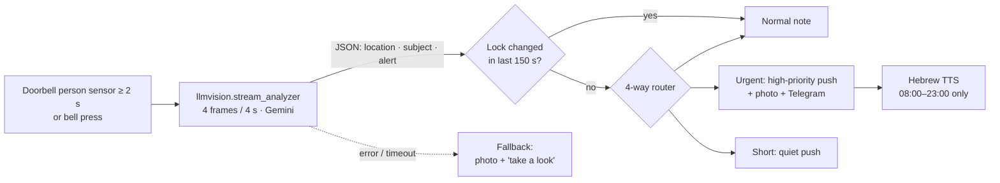

</div>

## פרמטרים טכניים

| פרמטר | ערך |
|---|---|
| פלטפורמה | Home Assistant 2026.9 על Home Assistant OS |
| היקף | 669 ישויות · 80+ אוטומציות · 5 סקריפטים · 54 אינטגרציות · 39 רכיבי HACS · 11 תוספים · 12 מסכי דשבורד |
| תוספים עיקריים | Zigbee2MQTT, Mosquitto, Frigate, go2rtc, Matter Server, Studio Code Server, Samba, שרת MCP |
| תעבורת מכשירים | Zigbee ← Zigbee2MQTT ← MQTT ‏(Mosquitto); וידאו דרך go2rtc / WebRTC; ‏Matter |
| טריגר ה-AI בדלת | חיישן person דולק לפחות 2 שניות, לכל היותר הרצה אחת ב-2 דקות, או לחיצה על הפעמון |
| בקשת ה-AI בדלת | `llmvision.stream_analyzer`, ‏4 פריימים לאורך 4 שניות, `temperature 0.2`, ‏`continue_on_error` |
| סכמת הפלט | `location` (‏9 ערכים) · `subject` (‏8) · `alert` (‏3: `high` / `normal` / `ignore`), ועוד `title` / `description` בעברית |
| חלון הווטו של המנעול | שינוי מצב בתוך 150 שניות |
| תגובה להתראה | פוש קריטי · קבוצת התריסים ל-0% · מזגן כבוי · ספירה לאחור בקול מ-30 עד 5 שניות · `mode: restart` |
| ונטה | 60 שניות של נוכחות mmWave רצופה להדלקה · 3 מסלולי כיבוי בלתי תלויים |
| תחזית סוללות | חיישן `statistics` ‏(`change`, ‏`max_age` של 30 יום) לכל סוללה · אזהרה כשנשארו 45 יום או פחות |
| חריגת צריכה | התראה יומית על יום של ‎+40% בצריכה |
| שעות שקט (הקראה) | 23:00–08:00 |
| גישה לטלגרם | רשימת היתר של 2 מזהי משתמש, נבדקת בכל אוטומציית פקודה |
| סיכומים | סיכום AI יומי ב-20:00 · שבועי ביום שישי · דוח סטטיסטיקה ביום ראשון |
| דוגמאות מנוקות | 9 קובצי YAML, ‏532 שורות, תחביר `triggers:` / `actions:` ‏(HA 2024.10+), מזהים לדוגמה ו-`!secret` |
| אתר התצוגה | קובץ `index.html` יחיד (כ-105KB), JS/CSS מוטמעים, גופני Heebo ו-JetBrains Mono מאוחסנים מקומית (OFL), בלי CDN, ‏GitHub Pages |

## החלטות הנדסיות

| # | ההחלטה | למה | המחיר |
|:-:|---|---|---|
| 01 | **כיוון לפי שינוי לאורך זמן, לא לפי פריים אחד** | תמונה אחת לא מבדילה בין מגיע ליוצא. ארבעה פריימים וכללי גודל מפורשים כן. | יותר טוקנים ועוד כ-4 שניות לכל אירוע. |
| 02 | **המודל מחזיר סכמה, לא פרוזה** | ערכים סגורים וטמפרטורה נמוכה הופכים את הניתוב לדטרמיניסטי. הטקסט החופשי בעברית נועד לבני אדם בלבד. | כל מה שמחוץ לרשימה הסגורה הופך ל-`unknown`. |
| 03 | **לתת לחיישנים אחרים וטו על התראת שווא** | הבדיקה "המנעול זז ב-150 השניות האחרונות" הפכה "זר בדלת" שקרי, שהגיע כל לילה, להודעה רגילה. | זר שמגיע מיד אחרי שדייר יצא יקבל עדיפות נמוכה יותר. |
| 04 | **לכל מסלול AI יש פולבק פשוט** | ‏`continue_on_error` וענף של תמונה בלבד: גם כשהענן נפל, התמונה מגיעה. | עוד ענפים לתחזק ולבדוק. |
| 05 | **לשאול, לא לפעול, כשאפשר לטעות** | תריסים נסגרים לבד רק בחירום. שמש, חום וגשם מייצרים שאלה וכפתור. | פעולות נוחות דורשות לחיצה. |
| 06 | **סקריפט התראות אחד, נקודת שינוי אחת** | שדות `audience` / `critical` / `keyboard` / `channels`. החלפת טלפון היא עריכה של קובץ אחד, לא של 60 אוטומציות. | כל האוטומציות תלויות בסקריפט אחד. |
| 07 | **להניח שחיישנים ייתקעו ושקשר הרדיו ייפול** | שלושה מסלולי כיבוי לוונטה; ל-Zigbee יש restart ← בדיקה ← הסלמה; הגיבויים נבדקים על ידי אוטומציה נפרדת. | יותר אוטומציות לכל פיצ'ר. |

## מה חדש (אוקטובר 2026)

- **ניתוח וידאו בדלת עם `stream_analyzer`.** מצלמת הכניסה שולחת עכשיו **4 פריימים ב-4 שניות** למודל הראייה, והפרומפט כולל מפה כתובה של גאוגרפיית המסדרון. כך הוא מבחין בין **שכן שעובר בזמן שמישהו עומד אצלנו בדלת** לבין מישהו שבא אלינו.
- **בלי התראת שווא ביציאה מוכרת.** אם המנעול החכם השתנה ב-**150 השניות האחרונות**, מי שליד הדלת הוא אחד מאיתנו שיוצא, וההתראה לא נשלחת.
- **ונטה בשירותי האורחים לפי mmWave.** היא נדלקת רק אחרי **דקה של נוכחות רצופה**, ויש לה **שלוש דרכי כיבוי נפרדות**.
- **התריסים מדגם TS130F שומרים על הכיול.** המודולים איבדו את כיול נקודות הקצה. התיקון נעשה ב**הגדרות ההתקן דרך MQTT**, לא באוטומציה עוקפת.
- **שעות שקט.** בלי הקראה **בין 23:00 ל-08:00**; טלגרם ו-push נשלחים תמיד.
- **80+ אוטומציות** בסך הכול.

YAML מנוקה לשעות השקט ולבדיקת היציאה המוכרת: [`examples/quiet-hours-and-exit-suppression.yaml`](examples/quiet-hours-and-exit-suppression.yaml) (מזהי ישויות לדוגמה ו-`!secret` בלבד).

## לעומק: מצלמת דלת שיודעת לאיזה כיוון אתה הולך

**הבעיה.** בתמונה בודדת, "מישהו הולך לכיוון הדלת" ו"מישהו מתרחק ממנה" נראים כמעט אותו דבר. הגרסה הראשונה תיארה פריים אחד וטעתה מספיק פעמים כדי להיות חסרת תועלת.

**הפתרון: לשפוט תנועה, לא תמונה.**

1. **טריגר:** חיישן ה-person של הפעמון דולק לפחות 2 שניות (מוגבל להרצה אחת כל 2 דקות), או שמישהו צלצל.
2. **`llmvision.stream_analyzer`** שולח ל-Gemini **ארבעה פריימים לאורך ארבע שניות**, עם `temperature 0.2`.
3. בפרומפט יש **מפה כתובה של המסדרון**: באיזה צד חדר המדרגות, המעליות, דלתות השכנים והשטיחון שלנו. יש בו גם כללים מפורשים. הדמות גדלה ← חוזר הביתה. הדמות קטנה ← יוצא. אותו גודל וחוצה את הפריים ← עובר במסדרון. חיית מחמד או שקיות מרמזות שזה דייר, אבל **לא** קובעות כיוון. אם לא ברור, התשובה היא `unknown`, בלי ניחוש. חפצים שתמיד נמצאים במסדרון אינם אירוע.
4. המודל חייב לענות ב**סכמת JSON עם ערכים סגורים**. הניתוב קורא שדות, אף פעם לא טקסט חופשי.
5. **וטו לפי הקשר:** אם המנעול החכם שינה מצב ב-150 השניות האחרונות, מי שבדלת הוא כמעט בוודאות דייר, ולכן זה לא דחוף.
6. **נתב של ארבעה מסלולים:** *פולבק* (ה-AI נכשל ← עדיין שולחים תמונה), *דחוף* (פעמון, או זר בדלת ← פוש בעדיפות גבוהה, תמונה וטלגרם לשני הטלפונים), *קצר* (עבר מהר מדי ← פוש שקט בלי תמונה), *רגיל*.
7. **הקראה ברמקול** רק כשזה חשוב (בדלת / חוזר הביתה / פעמון / ה-AI נפל), ורק בין 08:00 ל-23:00.


<div dir="ltr">

```jsonc
{
  "title": "דייר חוזר הביתה",
  "description": "אדם עם שקיות קניות מגיע מכיוון המעליות ומתקרב אל השטיחון. הדמות גדלה לאורך הרצף ופניו למצלמה — נכנס הביתה.",
  "location": "arriving_home",
  "subject": "resident",
  "alert": "ignore"
}
```

</div>

<details>
<summary><b>שליח בדלת ← מסלול דחוף</b> (לחצו)</summary>
<br/>

</details>

**לכל צעד של AI יש פולבק פשוט.** הקריאה למודל רצה עם `continue_on_error`. אם Gemini לא עונה, האוטומציה עדיין שולחת את התמונה עם *"הפענוח לא הצליח, תסתכל בעצמך"*, ועדיין מקריאה ברמקול. תקלה בענן אף פעם לא בולעת התראה.

קוד מנוקה: [`examples/door-camera-ai.yaml`](examples/door-camera-ai.yaml)

## פיקוד העורף: 90 השניות הראשונות, אוטומטית


הטריגר הוא חיישן ההתראות הרשמי של האזור שנבחר. ואז, בהרצה אחת: שמירת שעת ההתחלה והגדלת המונה השבועי, הדלקת הדרך למרחב המוגן, סגירת קבוצת התריסים, כיבוי המזגן, **פוש קריטי** שעוקף "נא לא להפריע", וטלגרם עם שמות האזורים מתוך ההתראה. אחר כך מגיעה הודעה קולית בעברית ברמקול הסלון, ואחריה **ספירה לאחור מ-30 עד 5 שניות**. אוטומציה נפרדת מודיעה כשההתראה הסתיימה.

בזמן ההתראה פס הסטטוס בדשבורד הופך לאדום ופועם, הספירה לאחור רצה, והכרטיסים מראים מה הבית כבר עשה: אורות דלקו, התריסים ב-0%, המזגן כבוי.

קוד: [`examples/home-front-alert.yaml`](examples/home-front-alert.yaml)

## טלגרם: לדבר עם הבית


- **מבט לפי דרישה:** `/salon`, `/entrance` או סתם טקסט בעברית. הבוט מצלם פריים חי, מריץ `llmvision.image_analyzer` ועונה בשורה אחת.
- **הודעות עם כפתורים:** כל כפתור מפעיל אוטומציה קטנה (`/close_lights`, `/close_shutters`, `/close_ac`, `/lock_door`, `/close_all`).
- **אבטחה:** כל אוטומציית פקודה בודקת את השולח מול **רשימת היתר של שני משתמשים** לפני שהיא עושה משהו.
- **סיכומים:** כל אירוע ראייה נרשם ביומן ציר זמן. יש סיכום יומי ב-20:00 וסיכום שבועי ביום שישי. ביום ראשון מגיע דוח עם שיאי טמפרטורה, פתיחות דלת, מספר ההתראות, מהירות הרשת והגיבוי האחרון.

## הדשבורד

שנים-עשר מסכים שבניתי ידנית עם **mushroom, ‏card-mod ו-layout-card**. המשטחים שקופים כזכוכית, ל**כל תחום יש פס עליון צבעוני של 3px**, וכל כרטיס מגיב למצב בזמן אמת דרך Jinja. הממשק כולו **מימין לשמאל**. **מסך החשמל** קורא ישירות את המונה החכם של חברת החשמל: צריכה יומית וחודשית, תחזית לחשבון הבא, פרטי החשבון האחרון והתעריף. הצילומים בגלריית [המסכים](#מסכים).

## כל השאר

<details>
<summary><b>רשימת המודולים המלאה</b> (לחצו)</summary>

| תחום | עיקרי הדברים |
|---|---|
| **אבטחה** | התראה על דלת שנפתחה בלילה · התראות על דלת פתוחה אחרי 5 ו-15 דקות · נעילה אוטומטית ביציאה · תזכורת נעילה בלילה · זיהוי אדם בסלון כשאין אף אחד בבית (אופציונלי) |
| **בטיחות** | התראת פיקוד העורף וסיום התראה · אזהרה על גשם כשתריסים פתוחים (עם שם כל תריס) · תזכורת לדוד אחרי שעה · מזגן דולק כשאין אף אחד בבית |
| **נוחות** | ברכת "ברוך הבא" אישית · הצעה לסגור תריסי מערב בשמש ובחום · כיבוי אורות בחצות עם אזהרה ב-23:55 וכפתור *ביטול* בטלגרם · סקריפטים למזגן: מחזור מהירויות, נדנוד ו**מצב שבת** · שעות שקט להקראה (23:00–08:00) |
| **נוכחות** | מעקב לפי טלפונים · סיכומי יציאה מהבית · נוכחות mmWave בשירותים · מעקב iBeacon |
| **אנרגיה** | חיבור ישיר למונה החכם · התראה יומית על צריכה חריגה של ‎+40% · מסך עלות חשמל לפי מכשיר |
| **אמינות** | התראות על הצלחה, כישלון, העלאה לענן ופער של 3 ימים בגיבויים · ניתוק, חיבור מחדש ו-restart אוטומטי של Zigbee, עם דוח חודשי · ניטור זמינות של אתרים |
| **סוללות** | בדיקה יומית · תחזית 30 יום · תזכורת קנייה כש-3 ומעלה חלשות · מצב חופשה לסוללת המנעול · דוח חודשי |
| **דוחות** | סיכומי AI יומי (20:00) ושבועי (שישי) · דוח סטטיסטיקה ביום ראשון · דוח טמפרטורות בבוקר |

</details>

## טכנולוגיה והנדסה

- **פלטפורמה:** ‏Home Assistant 2026.9 על Home Assistant OS, עם 11 תוספים (Zigbee2MQTT, Mosquitto, Frigate, go2rtc, Matter Server, Studio Code Server, Samba, שרת MCP ועוד).
- **סגנון אוטומציות:** תחביר `triggers:` / `actions:` מודרני, מזהי טריגר ונתבי `choose`, בלוקי `variables` לתבניות קריאות, לולאות `namespace()` לאיסוף מצב, ו-`mode` / `max_exceeded` מפורש לכל אוטומציה.
- **AI:** ‏LLM Vision ‏(HACS) עם Google Gemini: פלט JSON מובנה עם ערכים סגורים, ניתוח רב-פריימי ותמונה בודדת, ויומן ציר זמן.
- **ממשק:** ‏mushroom, ‏card-mod (עם `style: >` כדי ש-Jinja ייושם), ‏layout-card, ‏vertical-stack-in-card, ‏apexcharts, ‏mini-graph, ‏navbar-card לניווט תחתון ביד אחת, ותוכנית בית ב-picture-elements.
- **אינטגרציות בולטות:** פיקוד העורף, המונה החכם של חברת החשמל, Reolink, ‏Dreame ו-Roborock, ‏LG ThinQ / webOS, ‏Broadlink, ‏UptimeRobot, ‏Waze, ‏PirateWeather.

## מבנה הריפו

<div dir="ltr">

```
.
├── README.md / README.he.md      # this showcase (EN / HE)
├── index.html                    # the live interactive showcase (GitHub Pages)
├── .nojekyll
├── assets/                       # real screenshots (redacted), diagrams, self-hosted fonts
│   └── fonts/                    # Heebo + JetBrains Mono woff2 (OFL)
└── examples/                     # sanitised YAML: placeholders + !secret only
    ├── README.md
    ├── door-camera-ai.yaml
    ├── quiet-hours-and-exit-suppression.yaml
    ├── notify-household-script.yaml
    ├── home-front-alert.yaml
    ├── presence-fan.yaml
    ├── battery-forecast.yaml
    ├── leaving-home-summary.yaml
    ├── zigbee-self-heal.yaml
    └── sun-shutter-advisor.yaml
```

</div>

## פרטיות והיקף

| מה פורסם | מה לא פורסם |
|---|---|
| ארכיטקטורה, לוגיקת האוטומציות, תכנון הפרומפט, סגנון הדשבורד, YAML מנוקה עם מזהים גנריים והפניות `!secret` | תמונות אמיתיות ממצלמות, תוכנית הדירה, כתובת או מיקום, שמות הדיירים, מספרים סידוריים, מספרי חשבון ומונה, כתובות רשת, מזהי צ'אט, טוקנים |

הדוגמאות הן חומר עזר, לא חבילה להתקנה. הפרומפטים תורגמו מהמקור העברי; משפטי ההקראה (TTS) נשארו בעברית, כי זה מה שהבית באמת אומר.

</div>

---

<div align="center"><b>Built by <a href="https://github.com/galasulin">Gal Asulin</a>, IT Manager</b></div>

<div align="center"><sub>תצוגות נוספות: <a href="https://github.com/galasulin/clinic-crm">clinic-crm</a> · <a href="https://github.com/galasulin/apostherapy-case-study">apostherapy-case-study</a> · <a href="https://github.com/galasulin/super-asulin-showcase">super-asulin-showcase</a> · <a href="https://github.com/galasulin/supermarket-barcode-scanner">supermarket-barcode-scanner</a></sub></div>
