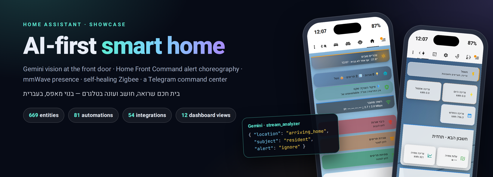
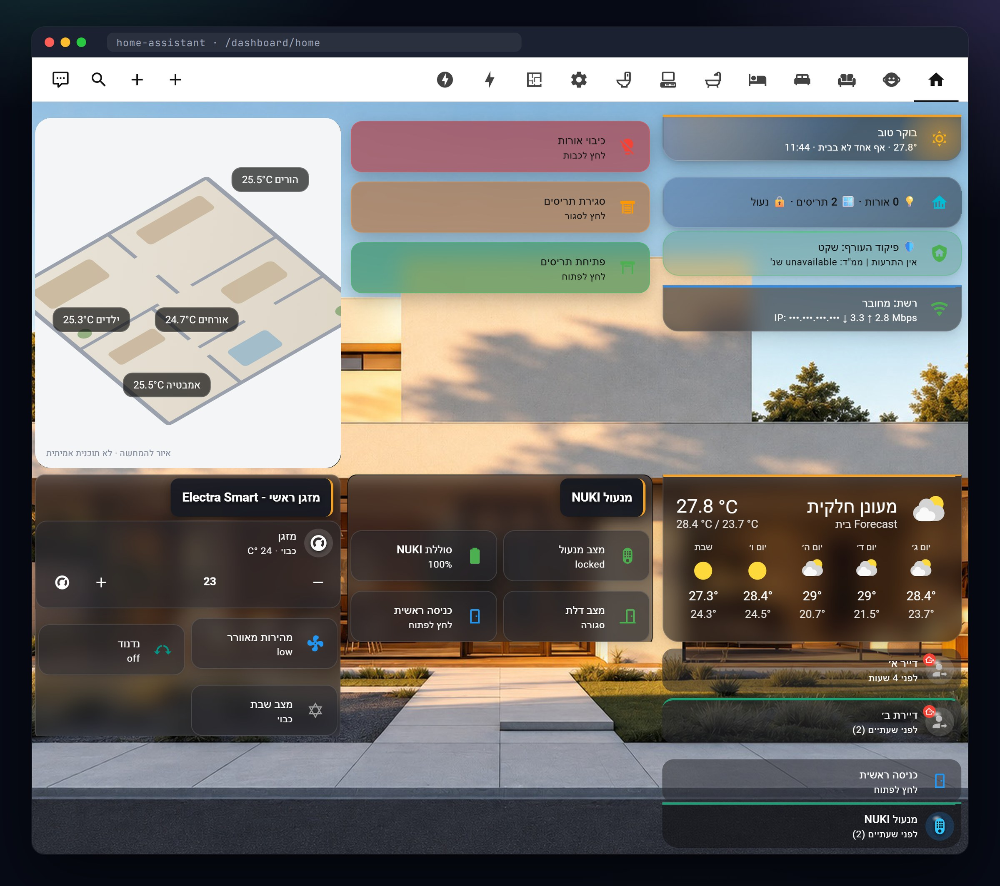
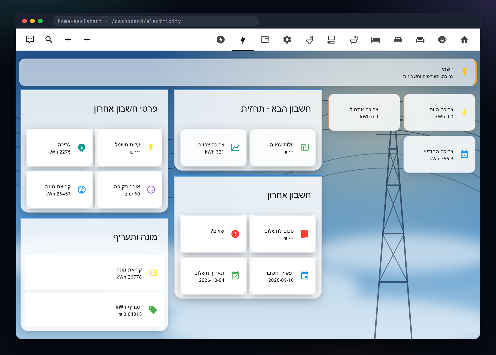
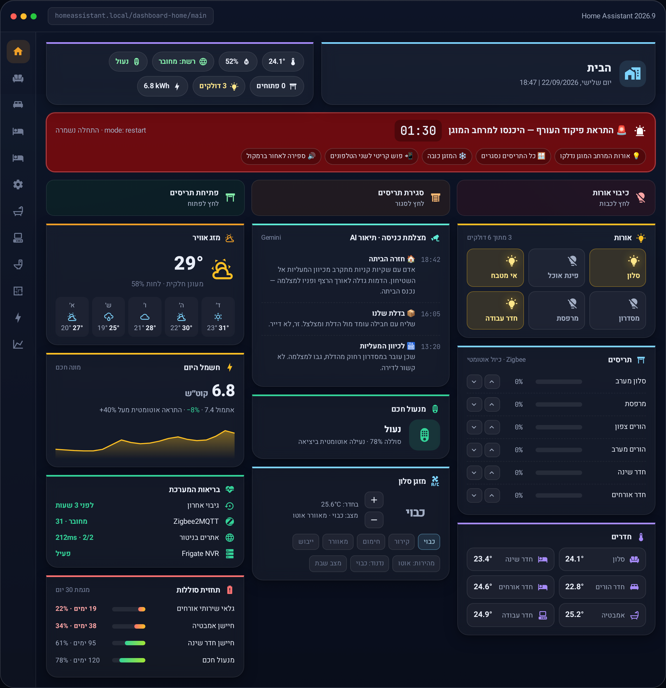
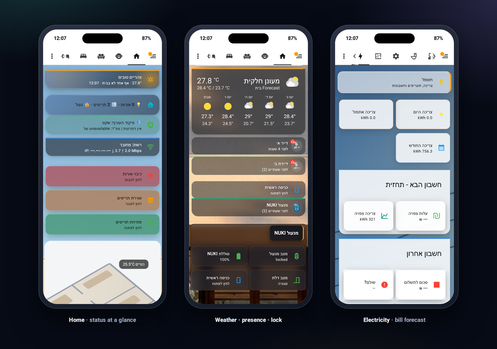
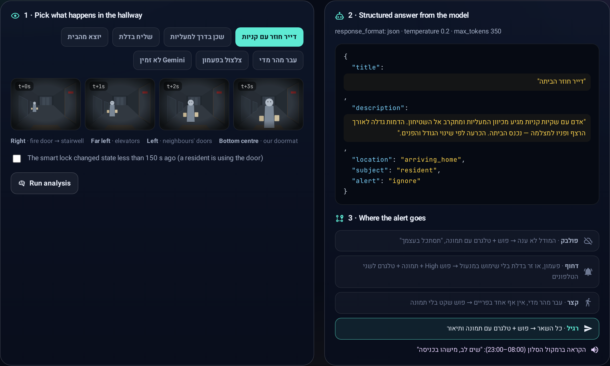
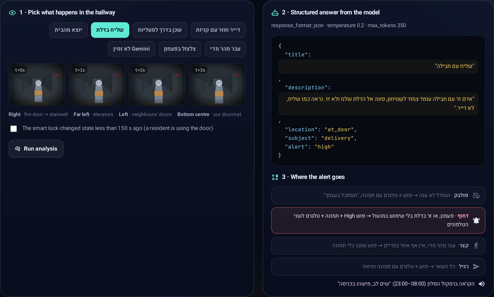
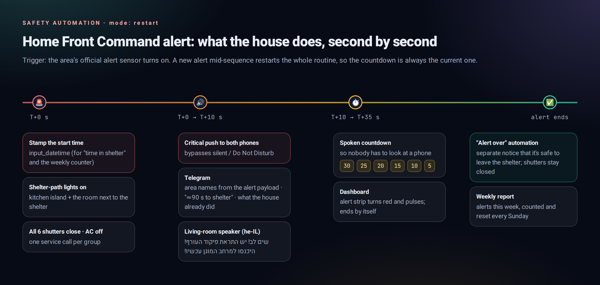
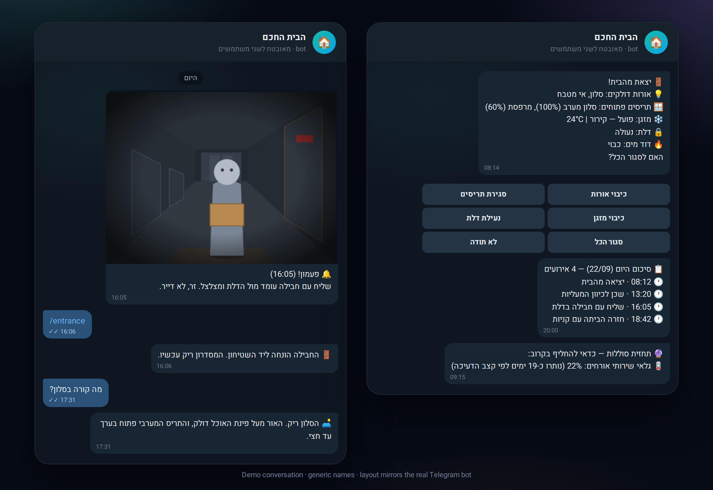
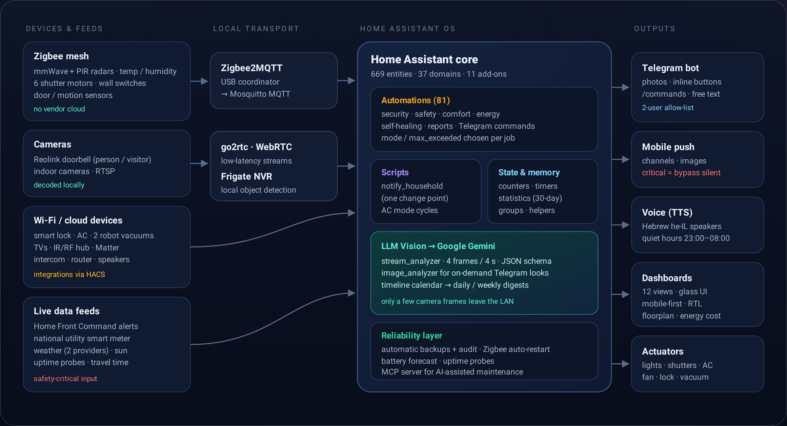

<div align="center">



<br/>

### An AI-first smart home I designed and built from scratch on Home Assistant, native in Hebrew.

*Gemini vision at the front door · Home Front Command alert choreography · mmWave presence · self-healing Zigbee · a Telegram command center*

<br/>


<br/>

**[✨ Live interactive showcase →](https://galasulin.github.io/smart-home-showcase/)**
*Click the dashboard, fire a simulated missile alert, and run the door-camera AI on seven hallway scenarios. It's a faithful recreation that runs on demo data.*

<br/>

> **Showcase repository.** This repo documents how the house works and why it was built that way.
> Nothing here connects to the real home. No camera frames, floor plan, location, names, serials, account numbers or chat IDs are published.
> 🇮🇱 [**גרסה עברית מלאה**](README.he.md)

<br/>

| 669 | 81 | 54 | 39 | 11 | 12 |
|:-:|:-:|:-:|:-:|:-:|:-:|
| **entities** | **automations** | **integrations** | **HACS components** | **add-ons** | **dashboard views** |

</div>

---

## 🆕 What's new (Oct 2026)

- **Door video analysis with `stream_analyzer`.** The front-door camera now sends **4 frames over 4 seconds** to the vision model, and the prompt carries a written map of the hallway's geography. That is what lets it tell **a neighbour walking past while someone stands at our door** apart from a visitor for us.
- **No false alarm on a known exit.** If the smart lock changed in the **last 150 seconds**, a person at the door is one of us leaving, so the alert is suppressed.
- **Guest-toilet fan on mmWave presence.** It starts only after **a full minute of continuous presence**, and it has **three independent ways to turn off**, so a stuck sensor can't leave it running.
- **TS130F shutters keep their calibration.** These shutter modules were losing their end-stop calibration; the fix is in the **device settings over MQTT**, not in a workaround automation.
- **Quiet hours.** No spoken announcements **23:00–08:00**; Telegram and mobile push always go out.
- **56+ automations** after a clean-up pass.

Sanitised YAML for the quiet hours and the known-exit check: [`examples/quiet-hours-and-exit-suppression.yaml`](examples/quiet-hours-and-exit-suppression.yaml) (placeholder entity IDs and `!secret` only).

---

## 📖 The story

Most smart homes stop at "turn the light on from your phone". I wanted a house that **understands what is happening** and says so in plain Hebrew.

- The front-door camera doesn't just detect a person. It works out whether that person is **coming home, leaving, a neighbour walking to the elevators, or a courier standing at our door**.
- When a **Home Front Command** siren alert hits the area, the house handles the first 90 seconds by itself.
- Both phones can ask *"מה קורה בסלון?"* ("what's going on in the living room?") in Telegram and get back a one-line answer written by a vision model.

Everything is built on **Home Assistant OS**: 81 automations, 12 hand-built dashboard views and 54 integrations. The rule is **local where it matters**: Zigbee devices never touch a vendor cloud, and video is decoded and analysed on the LAN by Frigate. Cloud is used deliberately: a few frames go to Gemini for vision, notifications (with snapshots) go out through Telegram and mobile push, speech uses cloud TTS, and a few appliances (vacuums, AC, TVs) are cloud integrations.

> **Design philosophy:** automations should *help* the people living in the house, never fight them. The house acts on its own only in emergencies. For comfort it asks first and waits for a tap.

---

## ✨ Signature capabilities

<table>
<tr>
<td width="33%" valign="top">

### 👁️ Front-door vision AI
**4 frames over 4 seconds** go to Gemini with a written hallway map and an enum-constrained JSON schema. Direction comes from **size change across frames**. Lock activity vetoes false alarms. A four-way router decides who gets what.

</td>
<td width="33%" valign="top">

### 🚨 Missile-alert choreography
It lights the shelter path, closes all six shutters, turns the AC off, sends **critical pushes that bypass silent mode**, and runs a **spoken Hebrew countdown**. It uses `mode: restart`, so a second alert restarts the routine cleanly.

</td>
<td width="33%" valign="top">

### 💬 Telegram command center
`/salon`, `/entrance` or free text like *"מה קורה בסלון?"* grabs a live frame and returns a one-line AI answer. Inline buttons turn off lights, close shutters or stop the AC. It's locked to a **two-user allow-list**.

</td>
</tr>
<tr>
<td valign="top">

### 🚪 Leaving-home summary
Three minutes after a phone leaves the zone, one message lists every light still on, every open shutter with its %, and the AC, lock and water heater. Each one has **a one-tap fix button**.

</td>
<td valign="top">

### 📡 mmWave presence fan
PIR + mmWave radar. The fan starts only after **a full minute of radar-confirmed presence** and has **three independent off-paths**, so a stuck sensor can't leave it running.

</td>
<td valign="top">

### 🩺 Self-healing & forecasting
Zigbee restarts itself and escalates. **Battery death is predicted** from a 30-day drain trend, 45 days ahead. Backups are audited, websites are probed for uptime, and an energy watchdog flags a +40% day.

</td>
</tr>
</table>

---

## 🖥️ The dashboard

Twelve views, built by hand with **mushroom cards, card-mod and layout-card**. They have glass surfaces and a **coloured 3 px top rail per domain**, and every Jinja-driven card reacts to state. The whole UI is **native right-to-left**.



**The electricity view** reads the national utility's smart meter directly: daily and monthly consumption, a forecast for the next bill, the last bill's details and the current tariff.



<table>
<tr>
<td width="50%" valign="top">

**During a Home Front Command alert** the status strip turns red and pulses, the countdown runs, and the cards show what the house already did (lights on, shutters at 0 %, AC off).

<sub>This one is a faithful recreation, since a real alert can't be staged on demand.</sub>

</td>
<td width="50%" valign="top">



</td>
</tr>
</table>



<sub>Real screenshots of the running system, captured card by card. Before capture, people's names, IP addresses and bill amounts were replaced in the page, and the real floor plan was swapped for an illustration. Backgrounds: the <a href="https://github.com/willsanderson/Hemma">Hemma</a> demo image (MIT) and an original illustration.</sub>

---

## 👁️ Deep dive: a doorbell camera that knows which way you're walking

**The problem.** From a single snapshot, "someone is walking toward the door" and "someone is walking away" look almost the same. The first version of this automation described one frame and got it wrong often enough to be useless.

**The fix: judge motion, not a picture.**

1. **Trigger:** the doorbell's *person* sensor stays on for ≥ 2 s (rate-limited to one run per 2 min), or the doorbell is pressed.
2. **`llmvision.stream_analyzer`** sends **4 frames across 4 seconds** to Gemini, at `temperature 0.2`.
3. The prompt contains a **written map of the hallway**: which side is the stairwell, the elevators, the neighbours' doors, our doormat. It also has explicit rules. Growing across frames → arriving; shrinking → leaving; same size crossing the frame → passing by. A pet or shopping bags suggest a resident but **don't** decide direction. If it's unclear, the answer is `unknown`, never a guess. Permanent objects in the hallway are not events.
4. The model must answer in a **JSON schema with closed enums**. Routing reads fields, never free text.
5. **Context veto:** if the smart lock changed state in the last 150 s, whoever is at the door is almost certainly a resident, so it's not urgent.
6. **Four-way router:** *fallback* (AI failed → still send the photo), *urgent* (bell, or a stranger at the door → high-priority push + photo + Telegram to both phones), *short* (passed too fast → quiet push, no photo), *normal*.
7. **Voice** only when it matters (at the door / arriving / bell / AI down), and only between 08:00 and 23:00.



```jsonc
// What the model returns for the scenario above (description is Hebrew in production)
{
  "title": "Resident coming home",
  "description": "A person with shopping bags comes from the elevators toward our doormat; the figure grows across the sequence and faces the camera — entering the home.",
  "location": "arriving_home",   // at_door | arriving_home | leaving_home | hallway_passing | stairwell | garbage | elevators | unknown | empty
  "subject": "resident",         // delivery | neighbor | stranger | resident | child | pet | object | none
  "alert": "ignore"              // high | normal | ignore
}
```

<details>
<summary><b>Courier at the door → urgent route</b> (click)</summary>
<br/>

</details>

**Every AI step has a dumb fallback.** The vision call runs with `continue_on_error`. If Gemini times out, the automation still delivers the photo with *"couldn't analyse, take a look"*, and still speaks. A cloud hiccup never swallows an alert.

➡️ Sanitised source: [`examples/door-camera-ai.yaml`](examples/door-camera-ai.yaml)

---

## 🚨 Home Front Command: the first 90 seconds, automated



The trigger is the official alert sensor for the selected area. Then, in one run: it stamps the start time and increments the weekly counter, lights the path to the protected room, closes the shutter group, turns the AC off, sends a **critical push** (bypasses Do Not Disturb), and posts the alerted area names to Telegram. Next comes a Hebrew announcement on the living-room speaker, then a spoken **30 → 5 second countdown**. A separate automation announces when the alert is over.

➡️ [`examples/home-front-alert.yaml`](examples/home-front-alert.yaml)

---

## 💬 Telegram: talk to the house



- **On-demand looks:** `/salon`, `/entrance`, or plain Hebrew text. The bot takes a live frame, runs `llmvision.image_analyzer`, and answers in one line.
- **Actionable messages:** inline keyboards map to small command automations (`/close_lights`, `/close_shutters`, `/close_ac`, `/lock_door`, `/close_all`).
- **Security:** every command automation checks the sender against an **allow-list of two user IDs** before doing anything.
- **Digests:** every vision event is written to a timeline calendar. It's summarised daily at 20:00 and weekly on Friday. A Sunday report covers temperature records, door openings, alert count, network speed and the last backup.

---

## 🏗️ Architecture



| Layer | What runs there |
|---|---|
| **Devices** | Zigbee mesh (mmWave + PIR radars, temperature/humidity, 6 shutter motors, wall switches), doorbell + indoor cameras, smart lock, AC, 2 robot vacuums, TVs, IR/RF hub, intercom, Matter |
| **Local transport** | Zigbee2MQTT → Mosquitto MQTT · go2rtc / WebRTC for low-latency video · **Frigate NVR** for on-LAN object detection |
| **Core** | 81 automations (`mode` / `max_exceeded` chosen per job) · 5 scripts · counters, timers, 30-day `statistics` sensors, groups · automatic backups |
| **AI** | LLM Vision → Google Gemini: `stream_analyzer` (door), `image_analyzer` (Telegram looks), timeline + digests |
| **Outputs** | Telegram bot · mobile push (critical channel) · Hebrew TTS with quiet hours · 12 dashboard views · actuators |
| **Operations** | Studio Code Server · Samba · HACS (39 components) · an MCP server for AI-assisted maintenance |

---

## 🧠 Seven decisions worth reading about

| # | Decision | Why |
|:-:|---|---|
| 01 | **Direction from change over time, not from one frame** | A single snapshot can't tell arriving from leaving. Four frames and explicit size-change rules can. |
| 02 | **The model returns a schema, not prose** | Closed enums + low temperature make routing deterministic. The Hebrew free text is for humans only. |
| 03 | **Let other sensors veto a false alarm** | "The lock moved in the last 150 s" turned a nightly false "stranger at the door" into a normal note. |
| 04 | **Every AI path has a dumb fallback** | `continue_on_error` + a photo-only branch: if the cloud is down you still get the picture. |
| 05 | **Ask, don't act, when you might be wrong** | Shutters close automatically only in emergencies. Sun, heat and rain produce a question and a button. |
| 06 | **One notification script, one change point** | `audience` / `critical` / `keyboard` / `channels` fields. Swapping a phone means editing one file, not 60 automations. |
| 07 | **Assume sensors get stuck and radios drop** | Three independent off-paths for the fan; Zigbee restart → verify → escalate; backups audited by a separate automation. |

---

## 🧩 Everything else the house does

<details>
<summary><b>Full module list</b> (click)</summary>

| Area | Highlights |
|---|---|
| **Security** | Night door-open alert · door-left-open alerts at 5 and 15 min · auto-lock on departure · night lock reminder · Frigate person-in-living-room when nobody's home (optional) |
| **Safety** | Home Front Command alert + "alert over" · rain-coming-with-shutters-open warning (names each open shutter) · water-heater reminder after an hour · AC-on-with-nobody-home |
| **Comfort** | Personal welcome-home greetings · west-sun & heat shutter suggestion · midnight lights-off with a 23:55 warning and a Telegram *cancel* button · AC scripts for fan-speed cycling, swing and **Shabbat mode** · quiet hours for voice (23:00–08:00) |
| **Presence** | Phone-based person tracking · leaving-home summaries · mmWave bathroom presence · iBeacon tracking |
| **Energy** | Direct smart-meter integration · daily +40% anomaly alert · per-device electricity cost view |
| **Reliability** | Backup success / failure / cloud-upload / 3-day-gap alerts · Zigbee disconnect / reconnect / auto-restart + monthly report · website uptime probes |
| **Batteries** | Daily check · 30-day death forecast · shopping reminder when 3+ are low · lock-battery vacation mode · monthly report |
| **Reports** | AI daily (20:00) & weekly (Friday) digests · Sunday stats report · morning temperature report |

</details>

---

## 🛠️ Tech & engineering

- **Platform:** Home Assistant 2026.9 on Home Assistant OS, with 11 add-ons (Zigbee2MQTT, Mosquitto, Frigate, go2rtc, Matter Server, Studio Code Server, Samba, MCP server…).
- **Automation style:** modern `triggers:` / `actions:` syntax, trigger IDs + `choose` routers, `variables` blocks to keep templates readable, `namespace()` loops for inventories, and an explicit `mode` / `max_exceeded` per automation.
- **AI:** LLM Vision (HACS) with Google Gemini, using structured JSON output with enum constraints, stream (multi-frame) and single-image analysis, and a timeline calendar.
- **UI:** mushroom, card-mod (with a `style: >` fold scalar so Jinja is evaluated), layout-card grid, vertical-stack-in-card, apexcharts, mini-graph, navbar-card for a one-thumb bottom nav, and picture-elements floorplan.
- **Integrations of note:** Home Front Command alerts, the national utility's smart meter, Reolink, Dreame and Roborock, LG ThinQ / webOS, Broadlink, UptimeRobot, Waze travel time, PirateWeather.

---

## 📂 In this repository

```
.
├── README.md / README.he.md      # this showcase (EN / HE)
├── index.html                    # the live interactive showcase (GitHub Pages)
├── assets/                       # real screenshots (redacted) & diagrams
└── examples/                     # sanitised YAML — placeholders + !secret only
    ├── door-camera-ai.yaml
    ├── notify-household-script.yaml
    ├── home-front-alert.yaml
    ├── presence-fan.yaml
    ├── battery-forecast.yaml
    ├── leaving-home-summary.yaml
    ├── zigbee-self-heal.yaml
    └── sun-shutter-advisor.yaml
```

---

## 🔒 Privacy by design

| Published | Not published |
|---|---|
| Architecture, automation logic, prompt design, dashboard style, sanitised YAML with placeholder entity IDs and `!secret` references | Real camera frames, the floor plan, address or location, names of the people living here, device serials, account / meter numbers, network addresses, chat IDs, tokens |

---

<div align="center">

**Built by [Gal Asulin](https://github.com/galasulin), IT Manager.** IT manager, self-taught full-stack developer, home-lab tinkerer.

<sub>Other showcases: <a href="https://github.com/galasulin/clinic-crm">clinic-crm</a> · <a href="https://github.com/galasulin/apostherapy-case-study">apostherapy-case-study</a> · <a href="https://github.com/galasulin/super-asulin-showcase">super-asulin-showcase</a> · <a href="https://github.com/galasulin/supermarket-barcode-scanner">supermarket-barcode-scanner</a></sub>

</div>
